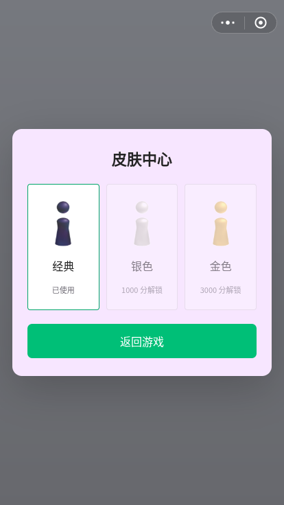
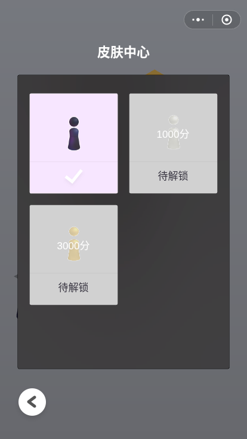

# 第五批验收：按历史源码恢复两列皮肤中心

日期：2026-11-10。基线：`347d616961bf37d073b873ed2a131dd619e52e33`。本批调整完整皮肤页，并修复实际键盘操作中复现的空格选皮肤失败。

## 可执行历史对照

参考为已声明的历史 4.0.6 提交 `4ef17b5fabec6a33e38501df4c75bae80950dccc`，不是当前官方版本。检查了 [skin.js](https://github.com/Men-HuLu/wechat-code/blob/4ef17b5fabec6a33e38501df4c75bae80950dccc/%E8%B7%B3%E4%B8%80%E8%B7%B3/_1079392110_64/js/pages/pages2d/skin.js)、同目录的 [base.js](https://github.com/Men-HuLu/wechat-code/blob/4ef17b5fabec6a33e38501df4c75bae80950dccc/%E8%B7%B3%E4%B8%80%E8%B7%B3/_1079392110_64/js/pages/pages2d/base.js) 及 [bottleShop.js](https://github.com/Men-HuLu/wechat-code/blob/4ef17b5fabec6a33e38501df4c75bae80950dccc/%E8%B7%B3%E4%B8%80%E8%B7%B3/_1079392110_64/js/pages/bottleShop/bottleShop.js)。

新增浏览器脚本实际执行该提交的 `skin.js`，以及 `base.js` 原始坐标、圆角矩形、绘图和文字函数；仅将 Three.js 画布上传与路由替换为平面 canvas 图层。基线、本批页面和历史绘制均使用同一浏览器尺寸、DPR、皮肤列表、解锁与选中状态。金银项输入现有重建预览作为离线夹具，不能据此声称它们是历史服务器原图。

设计画布为 414×736，缩放取 `min(W/414,H/736)` 并居中；历史绘制像素比上限为 2。以下均为设计坐标：

| 项目 | 历史绘制依据 | 本批处理 |
| --- | --- | --- |
| 标题 | 中心 (207,89)，22，粗体 Helvetica | 采用相同位置、缩放和字体声明 |
| 背景框 | `res/bl3.png`，左上 (30,126)，354×492 | 复用已有原始图片 |
| 两列卡片 | 左上 (50+167×列,157+187×行)，147×167，间距 20 | 三种离线皮肤排列为两列、两行 |
| 棋子预览 | 中心 (124+167×列,220+187×行)，33×66 | 经典使用 `res/defaultBottlePoster.png`；金银保留重建预览 |
| 选中 | `res/2d/sel.png`，中心 (123+167×列,296+187×行)，50×42 | 原图白勾替代绿色选中边框 |
| 已解锁未选中 | 淡紫卡片，状态“使用” | 保留真实选择行为 |
| 未解锁 | 灰底 #D1D1D1，预览透明度 .5，状态“待解锁” | 原有 1000/3000 分规则，门槛白字置于预览区域 |
| 返回 | `res/2d/new_return.png`，左上 (19,639)，70×70 | 原始返回图标与可访问按钮名称 |

实测 414×736 下，基线首卡 (40,268)、104.65625×184、三列；本批首卡 (50,157)、147×167、两列。320×568 下本批首卡约 (38.828,121.156)、113.438×128.875，与历史缩放结果相符；414×896 下整页居中产生 80 px 顶部留白。

4 组状态的基线均检测到明确差异；本批 4 组的卡片、预览、标题、背景框、返回、状态中心、选中图位置和尺寸差均不超过 0.05 CSS px，锁定背景色、透明度与选择状态一致。**这不是全画面像素相等结论**：Canvas/DOM 的字形栅格化、边框抗锯齿仍有差异，也未证明当前官方 1:1。

[原始对照数据与源码摘要](qa/round5/reference-results.json)。`skin.js` SHA-256 为 `e5d739901e8fd0ecc775f4ca9d810c6a6169698fc4842856ad93bf017ecf855e`；`base.js` 为 `9b9065da19c7b1d5c1984c8cfa24959c92734621b03e4e31f38fb8d422506c2f`。

| 基线 414×736，经典选中 | 本批同尺寸/状态 | 执行历史绘制代码 |
| --- | --- | --- |
|  |  |  |

## 保留的交互与降级

极短/极窄窗口采用可滚动的阅读布局，避免把历史画布缩成难操作的小按钮；该分支是浏览器适配，不声称历史布局完全相同。每次打开仍回到列表顶部，旋转时选择保持，所有卡片和返回按钮可通过滚动触达，短窗口标题避开右上菜单。

皮肤名称保留在可访问名称中；锁定按钮不可操作且 Tab 跳过，已选项保留 `aria-pressed`。预览失败时在预览区显示提示，选中与解锁状态仍保留。经典预览现在直接使用已有历史海报，因此生成预览编码/解码失败只影响金银；经典 DOM 图片展示失败仍有独立降级。三种皮肤的实际棋子材质、解锁规则、历史成绩、正常/无敌选项及来源说明保留；ASSETS 表 158 项逐字节未变。

键盘复现：在基线解锁银色后，Tab 聚焦银色、按空格无效，按 Enter 可选中。原因是全局 `keyup` 无条件阻止空格默认行为。本批仅在游戏确实持有蓄力按键时拦截该事件，恢复按钮原生空格操作；手动空格跳跃仍由主路径验证。

## 最终验证

被测 `index.html` SHA-256：`7e0991b245b755973e25d9b655ee08b154dbcada6e4cd6453ce0679e1382c70d`。下列结果均在这一最终产品文件上运行：

- **通过**：静态检查，3 段脚本与 158 个内嵌资源；完整 Node 回归 33/33，0 fail、0 skipped。
- **通过**：历史绘制对照 8 组（基线/本批各 4 组），含经典锁定态、金银解锁/选中，414×736、320×568、414×896 及 DPR 1/2/3。
- **通过**：已有布局脚本 13 组布局、4 次滚动重开、3 组保存选择与旋转；正常尺寸断言改为历史要求的**恰好两列**。
- **通过**：键盘与触控 6 项，含基线空格问题复现、Tab/Space/Enter/Escape、锁定跳过、单一白勾、重开和真实触控操作。390×320 下实际 CDP 触摸滑动令面板 scrollTop 从 0 到 165，没有误选；随后可点选金色、返回及菜单暂停/恢复。触控为浏览器模拟，未声称实体手机已验收。
- **通过**：主路径 14 项，含短/长蓄力、6 次手动连跳、落空返回、普通失败、皮肤反复切换/重开/重启/持久化和无远端运行请求。
- **通过**：原有生命周期 15 项，覆盖飞行和回位期间菜单、主页、重启、切换模式及迟到输入；其中 blur 注入不视为真实后台。
- **通过**：资源异常 5 项；生成预览故障时明确断言经典原海报仍可用、金银显示降级，独立展示故障及必要内嵌图加载故障仍覆盖。

[布局结果](qa/round5/layout-results.json) · [输入结果](qa/round5/input-results.json) · [主路径](qa/round5/core-results.json) · [生命周期](qa/round5/lifecycle-results.json) · [资源异常](qa/round5/skin-error-results.json) · [静态日志](qa/round5/static.txt) · [Node 原始日志](qa/round5/node.txt)

原有标签重叠回归现在检查每个绝对定位状态都由自己的卡片定位、且完整位于卡片内，取代旧的 `position:static` 实现断言；小窗口检查保留面板边界并逐项滚动验证完整可达性。没有删除重叠、边界、资源异常或玩法断言来通过测试。

[金色选中](qa/round5/current-414x736-gold.png) · [320×568 银色选中](qa/round5/current-320x568-silver.png) · [短窗口](qa/round5/current-320x200.png) · [键盘选择](qa/round5/keyboard-selected-gold.png) · [触控滑动后选择](qa/round5/touch-compact-selected-gold.png) · [预览故障降级](qa/round5/fallback-display.png)

本地复现（Node 20+，Playwright、Chromium；主路径录屏还需 Playwright 可用的 ffmpeg）：

```sh
node scripts/serve.cjs
# 另一终端执行
node scripts/check.cjs
node --test
node scripts/skins-layout-qa.cjs
node scripts/skin-input-qa.cjs
node scripts/skin-error-qa.cjs
node scripts/lifecycle-qa.cjs
QA_SKIP_FILE=1 node scripts/browser-qa.cjs

# 历史绘制对照另需只读参考 checkout，脚本用 git show 固定到上面的提交
git clone --filter=blob:none --no-checkout https://github.com/Men-HuLu/wechat-code.git /tmp/tiaoyitiao-reference
REFERENCE_ROOT=/tmp/tiaoyitiao-reference node scripts/skin-reference-qa.cjs
```

## 未验收与跳过

实体手机、Safari、真实前后台/休眠、动态跨显示器 DPR 切换、当前官方同版本画面和听感仍未验收。独立上下文 DPR 1/2/3 不等于实时 DPR 切换；历史同尺寸对照不等于当前官方验收。金银官方服务器原预览素材仍缺失，继续标明为既有重建材质。

`file://` 沿用已知托管浏览器 `ERR_BLOCKED_BY_ADMINISTRATOR` 限制，显式跳过，没有重试或绕过。此批没有新的待批准步骤。仅更新同一功能分支和草稿 PR，不推 main、不合并、不部署。
