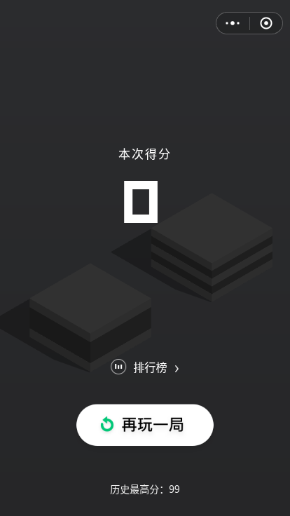
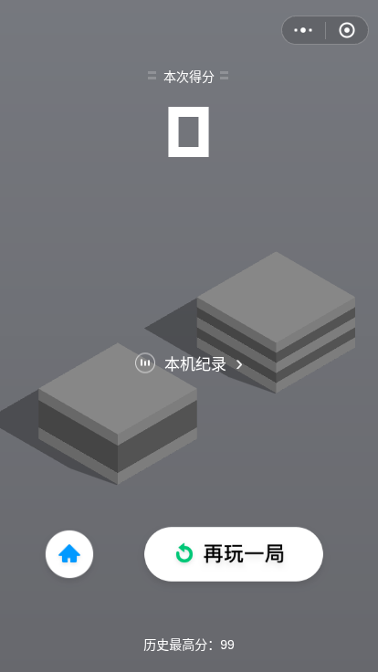
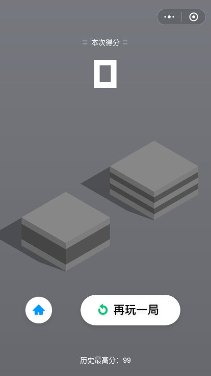

# 第六批验收：普通模式结算的得分区与导航

日期：2026-11-10。基线：`e4c2bdaa351e73f9c7071519793250dac71cc58a`。本批从皮肤页转向普通模式结算，修复有明确历史依据的共用区域，保留离线版本自己的纪录功能。

## 依据、复现与范围

参考仍是已声明的历史 4.0.6 提交 `4ef17b5fabec6a33e38501df4c75bae80950dccc`，不是当前官方版本。检查了 [gg.js](https://github.com/Men-HuLu/wechat-code/blob/4ef17b5fabec6a33e38501df4c75bae80950dccc/%E8%B7%B3%E4%B8%80%E8%B7%B3/_1079392110_64/js/pages/pages2d/gg.js) 中结算分支、普通得分 `c`、背景与最高分 `d`、主页/重玩 `p` 及新纪录绘制 `n`，并使用同目录 [base.js](https://github.com/Men-HuLu/wechat-code/blob/4ef17b5fabec6a33e38501df4c75bae80950dccc/%E8%B7%B3%E4%B8%80%E8%B7%B3/_1079392110_64/js/pages/pages2d/base.js) 的实际坐标、绘图和字体函数。

浏览器通过实际按键蓄力和失败到达结算，没有直接修改运行得分。基线 414×736 的普通结算中，得分标签中心 y≈218.58、数字中心 y≈294.39、字号≈95.22；历史对应为 y=84、y=150、字号88。基线遮罩为 .8，历史为 .45；底部缺少原主页按钮，重玩居中且位置不同。新纪录状态还存在分数标签、数字、庆祝图尺寸/位置差异。

以下均为 414×736 设计坐标，依现有居中缩放应用到其他正常尺寸：

| 共用项目 | 历史依据及本批行为 |
| --- | --- |
| 背景 | `rgba(0,0,0,.45)` |
| 普通得分标签 | “本次得分”，中心 (207,84)，14 Helvetica，含两侧短线装饰 |
| 普通分数 | 中心 (212,150)，88，原始数字字体 |
| 新纪录标签/分数 | “历史最高分”中心 (207,160)，14；分数中心 (207,244.5)，86、绿色 |
| 新纪录庆祝图 | `res/flower.png`，中心 (207,220)，260×141 |
| 主页 | `res/2d/new_home.png`，中心 (76,607)，74×74，按钮返回真实主页 |
| 重玩 | `res/replay.png`，中心 (256,607)，212×84，图片本身也按该尺寸绘制 |
| 最高分 | 中心 (207,706)，14，来自真实本机最高分 |

当前内嵌 `JumpDigits` 与参考 `res/num.ttf` 逐字节相同，SHA-256 为 `feb570ad109f1610daa8e19df7b38f9a29578fbbc1f21b3873300eba286f5f45`。素材已有，无新下载图像、字体或 ASSETS 变动。

新增脚本执行原始 `gg.js` 与 `base.js` 绘制代码：普通状态调用原始 `d/c/p` 共用区域，排除联网排行和分享；新纪录调用原始 `n`，使用空好友夹具。画布上传与服务入口被隔离为本地平面 canvas/空服务，实际绘图与坐标函数执行。对照覆盖基线和本批各 4 组：414×736 普通/新纪录，320×568 普通，414×896 新纪录，DPR 1/2/3。

本批指定得分标签、分数、最高分、主页/重玩图片、庆祝图的位置/尺寸和字体字号差不超过 0.05 CSS px，遮罩一致。**没有声称整页像素相等或当前官方 1:1**。基线的主要共用区域差异可重复复现；原始测量、源码和字体摘要见 [对照结果](qa/round6/reference-results.json)。

| 基线普通结算 | 本批普通结算 | 原始共用绘制 |
| --- | --- | --- |
|  |  |  |

## 离线例外与交互

中部保留实际打开本机纪录的按钮，文字明确为“本机纪录”；不生成好友头像、联网排名、周榜、挑战分享、广告或微信服务。保留已有“新的历史最高分”提示文字，没有扩展历史成就称号或伪造联网纪录。新纪录原始面板、徽章和分享按钮不属于此次整页还原范围；正常 Canvas/DOM 文字栅格化也未按像素验收。

极短/极窄窗口采用阅读尺寸和纵向滚动，不把完整历史画布缩成难操作的小按钮。旋转后分数与控制不横向溢出，标题避开胶囊菜单，主页/重玩都能完整滚动触达。新增滚动布局每次结算回到顶部，下一局不会残留新纪录装饰或旧滚动位置。长分数原有缩字号规则保留。

成绩与存档逻辑保留：实际跳跃得分才记录，零分失败不增加纪录；重玩、主页和菜单不重复记分，最高分、已选皮肤和普通/无敌偏好不丢失。无敌模式仍失误返回起跳点，菜单可恢复普通失败。

## 最终验证

最终 `index.html` SHA-256：`ccc0d5441adc4b55551fd1283cb210e0b10ca32335969a289a987062efcac556`。

- **通过**：静态检查，3 段脚本、158 项内嵌资源；ASSETS 表与基线逐字节一致。完整 Node 回归 **33/33，0 fail、0 skipped**。
- **通过**：历史结算对照 8 组，包含普通/新纪录、DPR 1/2/3 与原始数字字体一致性。
- **通过**：结算交互 6 项、7 组布局，覆盖普通结算、真实跳跃新纪录、纪录存档、键盘主页/重玩、菜单、旋转、短窗口滚动与重开。触控模拟含实际长按失败、滑动、点重玩和点主页。
- **通过**：已有主流程 14 项、生命周期 15 项、皮肤布局 13 组/重开 4 组/保存选择 3 组、皮肤键盘触控 6 项及资源异常 5 项，均重新在最终产品文件上运行。

[结算流程/布局](qa/round6/over-layout-results.json) · [主流程](qa/round6/core-results.json) · [生命周期](qa/round6/lifecycle-results.json) · [皮肤布局](qa/round6/skins-layout-results.json) · [皮肤输入](qa/round6/skins-input-results.json) · [资源异常](qa/round6/skin-error-results.json) · [静态日志](qa/round6/static.txt) · [Node 日志](qa/round6/node.txt)

[新纪录结算](qa/round6/current-414x736-new-best.png) · [320×568](qa/round6/current-320x568-normal.png) · [旋转与滚动](qa/round6/settlement-736x414.png) · [短窗口](qa/round6/settlement-320x200.png)

复现需先启动 `node scripts/serve.cjs`。新增检查为 `node scripts/over-layout-qa.cjs`；源码对照为 `REFERENCE_ROOT=/tmp/tiaoyitiao-reference node scripts/over-reference-qa.cjs`，参考 checkout 的获取方式同 [第五批](ACCEPTANCE-ROUND5.md)。开发环境需 Playwright、Chromium；运行主流程录屏需可用的 Playwright ffmpeg。这些浏览器脚本输出原始 JSON 与截图。

## 未验收与跳过

历史参考不等于当前官方同版本证明。实体手机、Safari、真实前后台/休眠、动态跨显示器 DPR 切换及当前官方画面和听感仍待验收。触控为浏览器模拟，blur 注入不冒充真实后台。

`file://` 沿用已知 `ERR_BLOCKED_BY_ADMINISTRATOR` 限制显式跳过，没有重试或绕过。本批没有新增待批准步骤；只更新同一功能分支与草稿 PR，不推 main、不合并、不部署。
