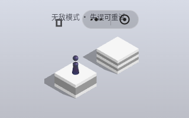
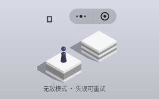

# 第七批验收：窄游戏容器中的模式提示遮挡

日期：2026-11-10。基线：`8804979fa61d652b7eca233848f5aadfdfc06e55`。本批核对游戏 HUD，保留已验证的数字渲染，只修复实际遮挡。

## 历史核对与真实复现

使用已声明历史 4.0.6 提交 `4ef17b5fabec6a33e38501df4c75bae80950dccc` 的 [ui.js](https://github.com/Men-HuLu/wechat-code/blob/4ef17b5fabec6a33e38501df4c75bae80950dccc/%E8%B7%B3%E4%B8%80%E8%B7%B3/_1079392110_64/js/ui.js)、[config.js](https://github.com/Men-HuLu/wechat-code/blob/4ef17b5fabec6a33e38501df4c75bae80950dccc/%E8%B7%B3%E4%B8%80%E8%B7%B3/_1079392110_64/js/config.js)、[text.js](https://github.com/Men-HuLu/wechat-code/blob/4ef17b5fabec6a33e38501df4c75bae80950dccc/%E8%B7%B3%E4%B8%80%E8%B7%B3/_1079392110_64/js/text.js) 和 [font.js](https://github.com/Men-HuLu/wechat-code/blob/4ef17b5fabec6a33e38501df4c75bae80950dccc/%E8%B7%B3%E4%B8%80%E8%B7%B3/_1079392110_64/js/font.js)。

测试浏览器中的隔离页面执行这些原始模块，构造参考 UI、字体与数字模型；使用当前 Three 引擎、以游戏容器为逻辑视口建立参考相机。测试探针只在浏览器副本中注入，读取实际分数网格和相机，将可见顶点投影到相同 CSS 像素坐标，不改变实际得分、变换或定时器。产品文件没有增加测试 API。

核对结果：普通 HUD 原有 `GAME_SCORE_POS`、字形数据、颜色和透明度均与历史实现一致。本批不修改它们，也不修改蓄力、射程、转体或落地参数。当前 `sumScore` 数字池的既有容量也保留。

实际问题来自离线版本保留的模式说明，它是有用的自定义信息，不应因历史版本没有就删除。其固定顶端位置在小容器中产生遮挡：

| 浏览器内容区域 | 实际游戏容器 | 基线问题 |
| --- | --- | --- |
| 240×320 | 240×320 | 无敌提示与右上胶囊菜单相交 |
| 320×200 | 170×200，居中 | 无敌提示同时遮住菜单和分数；普通提示也遮住分数 |
| 640×240 | 204×240，居中 | 无敌提示与胶囊菜单相交 |

320×200 基线中，提示顶端 y=20、底端 y=37，实际数字顶端约 y=32.217，两者发生重叠。此问题可通过真实页面开始游戏并调整窗口复现，无需伪造分数。

## 修复与对照

仅新增一条作用于 `#play-mode` 的容器查询：游戏容器宽度不超过 260 px 时，将提示放在底部，保留两侧空间、换行和底部安全区。正常尺寸维持原位置、文字和字体。

260 px 来自当前标签约 125.39 px、胶囊宽 96 px、右侧 10 px、左侧 7% 和间隔余量所需的头部宽度；同时测试 259/260/261 px 边界。按游戏容器判断，能够覆盖宽浏览器中的短游戏区域。两种模式使用相同位置规则，切换模式时容易找到状态。

模式文本继续显示，触控穿过只读提示能到达游戏画布；未移动历史分数，也未隐藏或缩小提示来通过检查。CSS 仅影响这一 HUD 后代，不改皮肤或结算页面样式。

| 320×200 基线 | 320×200 本批 |
| --- | --- |
|  |  |

[240×320 基线](qa/round7/baseline-240x320.png) · [240×320 本批](qa/round7/current-240x320.png) · [常规尺寸](qa/round7/current-414x736.png) · [触控和状态切换](qa/round7/touch-flow-240x320.png)

## 最终验证

最终 `index.html` SHA-256：`151445a9e995f106df5e0580fbf63a31a3265588a0c0da52e3d561c6d04021fd`。

- **通过**：静态检查，3 段脚本、158 个内嵌资源；ASSETS 表逐字节保留。完整 Node **33/33，0 fail、0 skipped**。
- **通过**：11 组尺寸 × 两种模式 × 基线/本批，共 **44 组**浏览器检查，含 DPR 1/2/3、259/260/261 px 边界及横竖窗口。基线复现 4 组遮挡；本批 22 组均无遮挡、标签完整处于游戏容器内。原有数字的可见顶点边界与执行历史模块的参考差小于 0.00001 CSS px，字形、颜色和透明度一致。
- **通过**：新增 **6 条实际流程**：真实按键跳跃得分、运行中旋转、穿过底部提示的触摸长按和无敌回位、菜单切到普通模式、普通失败和重玩、主页/皮肤页隐藏 HUD 并恢复游戏。得分、最高分和模式偏好保持。
- **通过**：已有主流程 **14 项**重新运行，覆盖手动短/长蓄力、连续跳跃、无敌/普通失败、菜单、重启及皮肤切换和持久化；无页面错误或远端运行请求。

[HUD 对照、实际流程、源码摘要与原始结果](qa/round7/hud-results.json) · [主流程结果](qa/round7/core-results.json) · [Node 原始日志](qa/round7/node.txt)

主流程首轮桌面路径 12 项通过后，移动模拟上下文的 `page.goto` 等待本地页面加载 30 秒超时，无页面脚本错误或远端请求。随后本地 HTTP 检查为 200、约 22 ms，完整响应摘要与产品相同；未修改产品、超时或断言，原样完整重跑。第二轮在连续跳跃中失败：请求 50 ms 的前一次短按实际记录约 510 ms，后续一次按目标距离计算蓄力的跳跃实际约 0.595 秒，越过目标；没有改动射程或降低落点断言。保留 [首次加载超时](qa/round7/core-first-attempt.json) 和 [第二次输入计时失败](qa/round7/core-second-attempt.json)。

最终复验使用可选 `QA_SKIP_VIDEO=1`，保留全部截图和原有断言；桌面路径完成后关闭其浏览器上下文，再启动移动上下文，避免让无关桌面动画和录屏继续占用资源。14 项均通过。录屏开启时的失败根因尚未确认，不将它们写成已修复的产品缺陷。

本批为限定于模式提示的 CSS 修改，未重复独立的完整皮肤布局、结算历史对照或 15 项生命周期浏览器脚本；其最近完整结果见 [第六批](ACCEPTANCE-ROUND6.md)。本批实际流程和主流程覆盖相关切换，完整 Node 仍覆盖已有生命周期回归。不将旧批次结果冒充本批重新运行。

复现：先运行 `node scripts/serve.cjs`；然后运行 `REFERENCE_ROOT=/tmp/tiaoyitiao-reference node scripts/hud-layout-qa.cjs`、`node scripts/check.cjs`、`node --test` 和 `QA_SKIP_FILE=1 QA_SKIP_VIDEO=1 node scripts/browser-qa.cjs`。历史参考 checkout 获取方式同 [第五批](ACCEPTANCE-ROUND5.md)。浏览器开发依赖与前批相同。

## 未验收与跳过

历史模块的数字几何一致，不等于整场景像素一致，也不是当前官方同版本 1:1 证明。DPR 使用独立上下文；实体手机、Safari、真实前后台/休眠、动态跨显示器 DPR、当前官方画面和听感仍未验收。

`file://` 沿用已知托管浏览器 `ERR_BLOCKED_BY_ADMINISTRATOR` 限制显式跳过，没有重试或绕过。本批没有新增待批准步骤；只更新同一功能分支与草稿 PR，不推 main、不合并、不部署。
