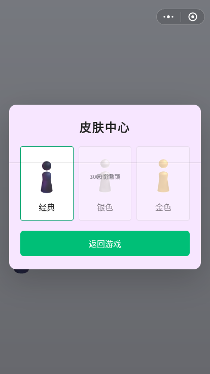
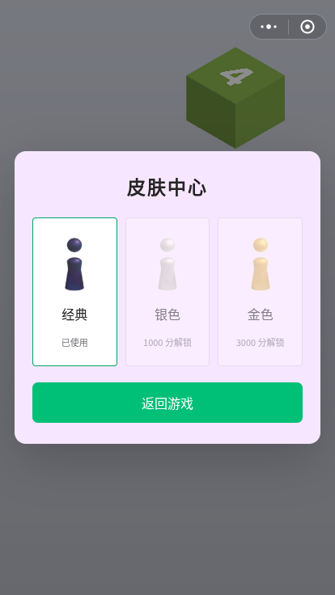

# 本批验收：无敌重试、运动衔接与皮肤

日期：2026-11-10。基线：`f1e477cb79c95367b76aaf3735fe14303a62f1ce`。

## 行为

- 默认无敌模式；仍需手动蓄力、松开和判断距离。落空或擦边失误后用 220 ms 返回**本次起跳点**，不跳到下一块、不加分，重置中心连击。落回原平台保持原有行为。
- 菜单可关闭无敌模式，保留原有失败动画和结束界面。当前设置立即生效并持久化为 `prefs.gameplayMode`。
- 旧存档迁移采用新的无敌默认值；不读取旧 `invincible` 开关。保留 `best`、`records`、声音、画质和已解锁皮肤；旧自动居中、倍分和全皮肤字段仍不启用。
- 无敌局中真实取得的最高分及时保存，供现有皮肤解锁使用。原有历史纪录不删改；普通模式的结束记分流程保留。无敌局主动回主页或重启不会额外生成一条结束纪录。
- 三种皮肤的预览统一由实际棋子模型生成。修复旧 `.skin-status` 的绝对定位污染，状态文字各归其卡片。金银材质仍为已有重建素材，没有改称原版资源。

## 运动证据

保留正常玩法的竖直公式 `y = y0 + vy*t - 360*t²`，以及原有蓄力、速度上限和圆整射程。未通过修改期待值改变既有射程测试。

本批修正浏览器适配器的动画调度：在精确延迟边界完成前一段姿势，再开始后一段；原先先执行延迟回调、后更新旧动画，会从过时的姿势开始衔接。主页两段演示的横向速度也改为与既定终点和飞行时间一致，消除落地时位置修正造成的小跳变。

以下测量直接运行基线与本批 `index.html` 的调度器及动画模块。转体先用 140 ms 转到 `-π`，再用 180 ms 转到 `-2π`；200 ms 处的解析期望为 `-4π/3`：

| 帧率 | 基线角度（弧度） | 本批角度（弧度） |
| --- | ---: | ---: |
| 30 Hz | -3.601473060 | -4.188790205 |
| 60 Hz | -3.906213088 | -4.188790205 |
| 120 Hz | -4.058583102 | -4.188790205 |

原始测量：[motion-comparison.json](qa/motion-comparison.json)。回归另覆盖 137 ms 的不规则步长及飞行中间位置。

读取了已声明来源的 [4.0.6 历史 bottle.js](https://github.com/Men-HuLu/wechat-code/blob/4ef17b5fabec6a33e38501df4c75bae80950dccc/%E8%B7%B3%E4%B8%80%E8%B7%B3/_1079392110_64/js/bottle.js) 和 [config.js](https://github.com/Men-HuLu/wechat-code/blob/4ef17b5fabec6a33e38501df4c75bae80950dccc/%E8%B7%B3%E4%B8%80%E8%B7%B3/_1079392110_64/js/config.js)，核对重力 720、基础竖直速度 135、速度增量 15/70 及 `_jump` 公式。本批没有官方同版本录屏或设备实测；这不构成当前官方 1:1 验收。

## 检查

- **通过**：`node scripts/check.cjs`，3 段脚本语法、158 项内嵌资源、无远程运行依赖；内嵌 ASSETS 表与基线逐字相同。
- **通过**：`node --test`，25 项测试（17 项既有测试中的旧存档迁移用例按上述新语义更新，新增 8 项）。
- **通过**：Chromium + Playwright 真实浏览器。短鼠标蓄力、长键盘蓄力、六次连续手动成功跳跃、非零起跳点的失误重试、连击重置、菜单冻结、重启、普通模式失败、模式持久化、蓄力中打开菜单与迟到松开、七次皮肤切换、材质映射和选择状态、重新开局及刷新持久化。
- **通过**：320×568、414×736、736×414 横屏、1440×900 下皮肤面板不溢出；触屏模拟长按失误重试。浏览器无页面异常和远程运行资源请求。
- **被环境策略阻止，未通过浏览器验收**：打开 `file:///workspace/tiaoyitiao/index.html` 返回 `ERR_BLOCKED_BY_ADMINISTRATOR`。没有绕过策略；后续运行使用 `QA_SKIP_FILE=1` 明确跳过。静态内嵌资源检查通过不能替代直接打开的浏览器实测。
- 浏览器原始记录：[browser-results.json](qa/browser-results.json)。录屏保留在执行环境的 QA 目录，截图随仓库提交。

复现：先运行 `node scripts/serve.cjs`，另一个终端运行 `node scripts/browser-qa.cjs`。这是可选开发检查，需要 Playwright、Chromium 和 Playwright 可找到的 FFmpeg；游戏及 Node 回归测试不需要安装这些依赖。脚本默认使用 `/usr/bin/chromium`，可用 `CHROMIUM_PATH` 更换；`QA_OUTPUT` 可指定证据输出目录。

## 画面

| 基线：状态叠在一起 | 本批：状态各归卡片 |
| --- | --- |
|  |  |

[连续跳跃](qa/gameplay.png) · [菜单](qa/menu.png) · [皮肤已解锁及选择](qa/unlocked-skins.png) · [普通模式结束](qa/normal-game-over.png) · [触屏重试](qa/touch-retry.png)

## 仍需后续验收

- 未验证当前官方版本的跳跃手感、界面像素和皮肤颜色一致性，需要注明版本和设备的官方对照录像或测量。本批仅对已复现缺陷和历史公式作结论。
- 未在实体 iPhone/Android、Safari 上实测；浏览器触屏模拟不能替代真机。
- 音频自动测试通过，未声称本批已经听感验收。
- 本批仅功能分支与草稿 PR，不合并、不触发 main 部署。CI 状态以 PR 上对应提交为准。
